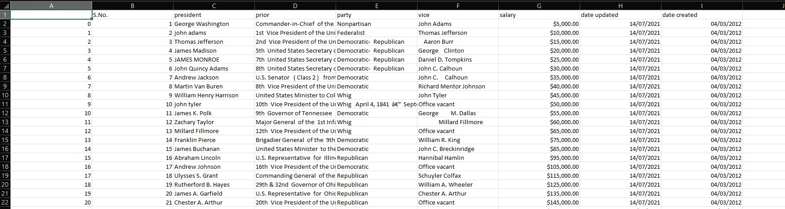
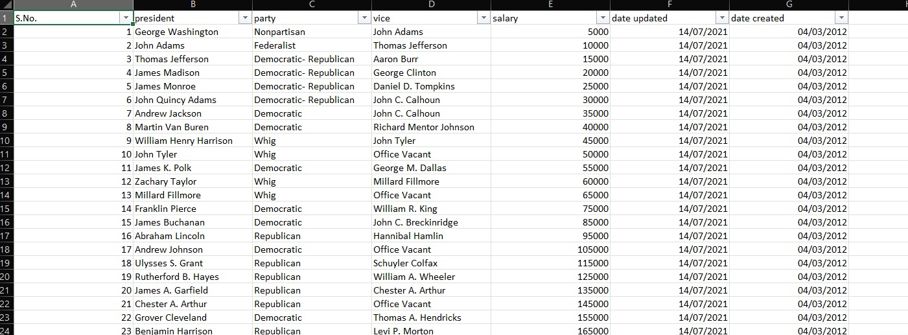

# US Presidents Data Cleaning

A messy dataset cleaned and standardized in Excel, ready for analysis.

## Before and after
| Before | After |
|---|---|
|  |  |

## Problems found and fixed
- Removed duplicate records
- Standardized inconsistent formats (like dates and names)
- Deleted an unnecessary column ("prior") to keep the table lean
- Standardized text case across names using PROPER
- Fixed formatting errors (e.g. alignment, spacing and column widths)

## Tools used
Microsoft Excel (Remove Duplicates, Text functions, Find & Replace, formulas)

## Data source
The dataset comes from the [Alex the Analyst](https://github.com/AlexTheAnalyst/Excel-Tutorial) data analysis course. The data cleaning and standardization in this project are my own work.

## Files
- `Data Cleaning Excel Tutorial.xlsx`: the Excel workbook with the data and my cleaning work
- `before.jpg` and `after.jpg`: screenshots of the data before and after cleaning
